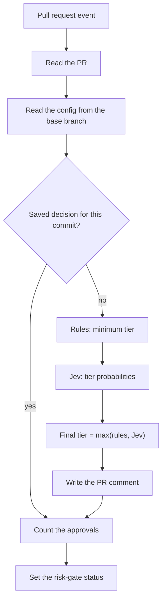

# How a run works

risk-gate runs on two kinds of events:

- **A new commit**, or a PR that opens: `pull_request_target`. risk-gate decides the tier.
- **A review** that someone submits or dismisses: `pull_request_review`. risk-gate reuses the decision and only counts the approvals again.

## The decision cache

risk-gate stores each decision in a hidden marker inside its PR comment. A later run reuses that decision when two things did not change:

- the head commit of the PR,
- the config file (risk-gate compares a hash of its text).

This gives two benefits:

- **Cost.** A PR costs one Jev call per commit, not one per event.
- **Stability.** The tier cannot change between two reviews of the same commit.

risk-gate reads the marker only from comments by `github-actions[bot]`, the account of the default `GITHUB_TOKEN`. A comment that another user writes cannot change the decision.

## The status

risk-gate sets a commit status with the context `risk-gate` on the head commit of the PR. The description gives the tier and the count, for example `high: 1/2 approvals`. GitHub limits the description to 140 characters.

| State | When |
|---|---|
| `success` | The PR has enough valid approvals and no reviewer who counts requested changes. Always `success` in shadow mode. |
| `pending` | Approvals are missing, or a reviewer who counts requested changes. |
| `error` | The config file is missing or not valid. |

The status links to the decision comment.

## The comment

The comment starts with the tier and the number of approvals, then lists the reasons:

- each rule that matched, with the files or the facts that made it match,
- the Jev tier and the probability of each tier,
- the agent rule, when it applies,
- the error, when Jev failed.

The footer shows the commit, the model, the number of input tokens and a short hash of the config.

## The job summary and outputs

Each run also writes the decision to the job summary and sets these step outputs: `tier`, `required-approvals`, `approvals`, `state` and `cached`. See [Action inputs and outputs](../reference/action.md).
